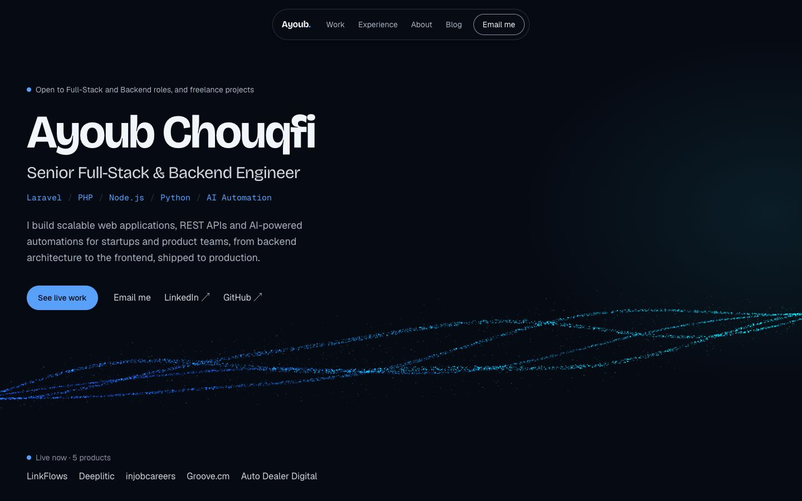

# Ayoub Chouqfi

**Senior Full-Stack & Backend Engineer** · Laravel · PHP · Node.js · Python · AI Automation\
Casablanca, Morocco · remote · open to Full-Stack and Backend roles, and freelance projects

I build scalable web applications, REST APIs and AI-powered automations for startups and product
teams, from backend architecture to the frontend, shipped to production.

**[Portfolio](https://ayoubchouqfi.vercel.app)** · **[Blog](https://ayoubchouqfi.vercel.app/blog)** · **[LinkedIn](https://www.linkedin.com/in/ayoub-chouqfi)**

## Live in production

4+ years and 25+ projects shipped to production. Most of that code is private client and company
work, so here are the products you can open today:

| Product                                                   | What it is                                  | My role                              |
| --------------------------------------------------------- | ------------------------------------------- | ------------------------------------ |
| [LinkFlows](https://linkflows.com)                        | AI content and social growth for publishers | Freelance client project             |
| [Deeplitic](https://deeplitic.com)                        | Privacy-first web analytics                 | Freelance client project             |
| [injobcareers](https://injobcareers.com)                  | Job board                                   | Freelance client project             |
| [Groove.cm](https://www.groove.cm)                        | All-in-one marketing suite, US              | Senior Software Developer, full-time |
| [Auto Dealer Digital](https://www.autodealersdigital.com) | Platform for car dealerships                | Full-Stack Developer, full-time      |

## Experience

- **Senior Software Engineer, freelance** (2025 – now): scalable backends and full-stack apps for
  clients with Laravel, PHP, Go and REST APIs; AI automation with LangChain and LLM integrations.
- **Senior Software Developer, Groovecm** (US, remote, 2023 – 2024): proposed and built the
  white-label system used across all Groove apps, an email builder and a campaign automation
  engine (Vue.js 3 + Laravel), and Stripe, PayPal and Payoneer subscriptions.
- **Full-Stack Developer, V12Software** (2023): cut API response time by 80% and moved the
  frontend to Vue.js and Tailwind.
- **Full-Stack Developer, MyRestAi Europe** (2022 – 2023): migrated a real-estate SaaS to Vue 3 and
  Laravel 10, and built its React Native app with property maps.

## Stack

- **Backend:** PHP 8, Laravel, Node.js, Python, Go, REST APIs, GraphQL, queues
- **AI automation:** LLM integration, LangChain, AI agents, OpenAI, Claude, Gemini, MCP
- **Frontend:** JavaScript, TypeScript, Vue.js 3, React, Next.js, Tailwind CSS
- **Mobile:** React Native, Expo, Ionic
- **Data and cloud:** MySQL, PostgreSQL, Redis, MongoDB, AWS (S3), Cloudflare, Docker, CI/CD

## Writing and open source

I'm writing a series on the open-source tools behind my products: how to use each one well, then
how to start contributing to it.

- [Maps with Leaflet: from your first map to your first contribution](https://ayoubchouqfi.vercel.app/blog/leaflet-maps-and-first-contribution)

Hiring, or have a project in mind? Write to me on [LinkedIn](https://www.linkedin.com/in/ayoub-chouqfi)
or through [my portfolio](https://ayoubchouqfi.vercel.app).
